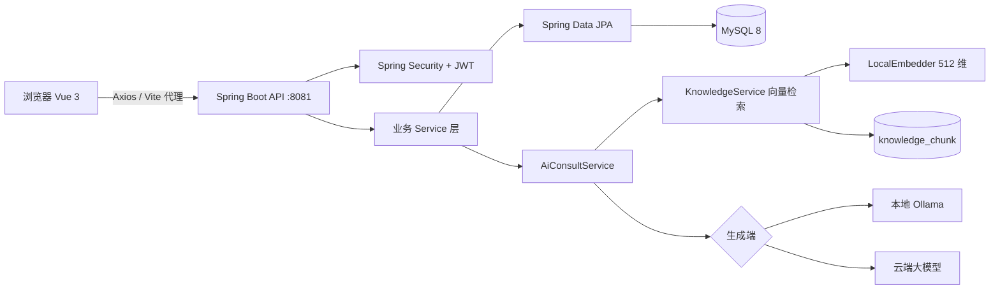

# agri-assist · 乡村数字化助农服务平台

> 个人全栈项目，用于求职作品集展示。技术栈：**Spring Boot 3 + Vue 3 + MySQL + Ollama（本地大模型）**。
> 差异化内核：**RAG 本地知识库智能咨询**——检索与生成均可在本机完成，数据不出域。

---

## ✨ 技术亮点（面试可重点讲）

- **检索增强生成（RAG）落地**：自研轻量向量化器 `LocalEmbedder`（字符 n-gram + 哈希映射为 512 维向量，零模型、零显存占用），对 `knowledge_chunk` 做余弦相似度检索取 Top-K，拼接为 prompt 送本地/云端大模型生成回答。
- **JWT 鉴权全链路**：Spring Security + JJWT 实现三角色（USER / ADMIN）无状态鉴权；关键写接口服务端二次校验权限，避免"仅前端拦截"的安全漏洞。
- **智能匹配与个性化推荐**：供需按"品类 + 地区 + 价格区间"规则匹配；推荐按"用户地区 + 订阅品类 + 热度 + 新鲜度衰减"多维打分排序。
- **社区激励体系**：发帖/评论/采纳最佳答案自动计分，积分排行榜 + 等级体系；认证徽章（实名/产地/合作/专家/质检）驱动信任。
- **数据可视化**：基于 ECharts 实现信息审核与运营统计面板。
- **工程化**：前后端分离、RESTful API、OpenAPI（Swagger）文档、JPA `ddl-auto:update` 平滑迭代表结构。

---

## 🛠 技术栈

**后端**
- Java 17 / Spring Boot 3.2
- Spring Security + JWT（jjwt 0.12.5）
- Spring Data JPA（Hibernate）+ MySQL 8
- SpringDoc OpenAPI（Swagger UI）
- 本地大模型集成：Ollama（`deepseek-r1:1.5b`）/ 可选云端 OpenAI 兼容接口（如混元、DeepSeek）

**前端**
- Vue 3 + Vite 5 + Vue Router 4
- Element Plus + ECharts 5
- Axios

**AI**
- 自研 `LocalEmbedder`：字符 1/2/3-gram + 哈希 → 512 维稠密向量
- 余弦相似度检索 Top-K（阈值兜底，低于阈值返回"未检索到"）
- 生成端可切换：本地 Ollama / 云端大模型 / 纯检索

---

## 📦 核心功能

| 模块 | 说明 |
| --- | --- |
| 用户与鉴权 | 三角色 JWT 鉴权；公开资料接口不泄露密码；当前用户可修改昵称/联系方式/地区 |
| 供需发布与智能匹配 | 供应/需求发布，按品类 + 地区 + 价格 ±区间规则自动匹配（未审核条目不参与匹配） |
| 预售预约 | 农产品预售发布、名额预约与统计 |
| **AI 智能咨询（RAG）** | 基于本地知识库的检索增强问答，支持本地/云端两种生成模式 |
| 农事互助社区 | 发帖 / 评论 / 采纳最佳答案；内容互动自动计分 |
| 信息审核与统计 | 供需 / 资讯 / 帖子多态审核；ECharts 运营统计面板 |
| 认证徽章 | 实名 / 产地 / 合作 / 专家 / 质检五类认证，审核通过后授予徽章 |
| 个性化推荐 | 地区 + 订阅品类 + 热度 + 新鲜度多维打分，跨供需/资讯/预售推荐 |
| 社区激励 | 积分体系（发帖/评论/最佳答案计分）+ 排行榜 + 等级称号 |

---

## 🏗 系统架构



**RAG 调用链路**：`POST /api/ai/ask` → `AiConsultService.ask()` → `KnowledgeService.retrieveScored(q,3)`（LocalEmbedder 向量化 + 余弦相似度 Top-3）→ 低于阈值返回兜底；否则按 `agri.ai.mode` 拼接 prompt 送 Ollama / 云端生成 → 回答与来源片段落库 `consultation`。

---

## 📁 目录结构

```
agri-assist/
├── backend/                 # Spring Boot 3 后端
│   └── src/main/java/com/agriassist/
│       ├── config/          # Security / JPA / OpenAPI 配置
│       ├── controller/      # REST 接口
│       ├── service/         # 业务层（含 ai / recommend / cert / point）
│       ├── repository/      # JPA Repository
│       ├── entity/          # 实体与表映射
│       └── dto/             # 请求/响应对象
├── frontend/                # Vue 3 + Vite 前端
│   └── src/
│       ├── views/           # 页面（供需/AI咨询/社区/认证/积分/推荐…）
│       ├── api/             # 接口封装
│       ├── router/          # 路由
│       └── styles/
├── db/                      # 数据库脚本
│   ├── schema.sql           # 建库建表
│   ├── seed_admin.sql       # 管理员种子
│   └── seed_supply_demand.sql # 供需演示数据
└── README.md
```

---

## 💻 环境要求

- JDK 17+
- Maven 3.9+
- Node.js 18+（建议 22）
- MySQL 8
- （可选，启用本地 AI）Ollama + 模型 `deepseek-r1:1.5b`

---

## 🚀 快速开始

```bash
# 1. 克隆
git clone <your-repo-url> agri-assist && cd agri-assist

# 2. 建库（MySQL 8）
mysql -uroot -proot -e "CREATE DATABASE IF NOT EXISTS agri_assist DEFAULT CHARACTER SET utf8mb4;"
mysql -uroot -proot agri_assist < db/schema.sql
mysql -uroot -proot agri_assist < db/seed_admin.sql          # 管理员账号
mysql -uroot -proot agri_assist < db/seed_supply_demand.sql  # 演示供需数据

# 3. 启动后端（默认 8081）
cd backend && mvn spring-boot:run

# 4. 启动前端
cd ../frontend && npm install && npm run dev
```

- 前端访问：http://localhost:5173
- 后端 API：http://localhost:8081/api/**
- API 文档（Swagger）：http://localhost:8081/swagger-ui.html

> 若 8081 被占用，后端用 `mvn spring-boot:run -Dspring-boot.run.arguments=--server.port=8082` 启动，并同步修改 `frontend/vite.config.js` 中 `/api` 代理目标。

---

## 🔑 演示账号

| 角色 | 用户名 | 密码 |
| --- | --- | --- |
| 管理员 | `admin` | `123456` |
| 普通用户 | 前端自助注册 | `123456`（本地开发库含 farmer_wang / farmer_li / 示例账号，口令同） |

> 生产环境请务必修改为强密码，并更换 `application.yml` 中的 `agri.jwt.secret`。

---

## 🤖 AI 智能咨询模块

位于 `com.agriassist.service.ai` 包：

- `LocalEmbedder`：本地轻量文本向量化（字符 n-gram + 哈希，零模型、零内存占用）
- `KnowledgeService`：知识入库（本地向量化）+ 向量检索（余弦相似度，带分数）
- `AiConsultService`：本地检索 Top-3 → 按 `agri.ai.mode` 决定生成方式
- `OllamaClient` / `CloudLlmClient`：本地 / 云端大模型客户端（OpenAI 兼容）

三种模式（见 `application.yml` 的 `agri.ai.mode`）：

- `local`：直接返回检索到的知识片段，不调用大模型
- `cloud`：检索片段作上下文，调用云端大模型生成回答
- `ollama`（默认启用）：检索片段作上下文，调用本地 Ollama 模型生成回答

调试接口：`GET /api/ai/mode` 查看当前模式与配置状态。

**启用本地 AI（ollama 模式）**

```bash
# 安装 Ollama 后拉取生成模型
ollama pull deepseek-r1:1.5b
# 验证
curl http://localhost:11434/api/tags
```

> 检索使用内置 `LocalEmbedder`（零模型、零内存），因此 ollama 模式下本机只需加载一个生成模型，且数据完全不出本机。

---

## ⚠️ 已知限制与后续优化

- **向量化为词面哈希（非语义嵌入）**：召回能力有限；后续可接入 `nomic-embed-text` 等真实嵌入模型 + PGVector / Chroma 向量库。
- **前端未渲染 Markdown**：AI 回答中的 `###` / `**` 以裸文本展示；后续引入 `marked` 渲染。
- **演示弱口令**：仓库内为演示账号，生产需强密码 + 更换 JWT 密钥。
- **知识库种子未随仓库提交**（大体积抓取数据已 gitignore）；空库时 AI 返回"未检索到"，可运行项目内 Python 采集脚本或自行导入 `knowledge_chunk` 数据。

---

## 📚 个人收获

独立完成需求拆解、架构设计、前后端开发、AI 模块集成与部署联调，覆盖：

- 前后端分离项目的工程化组织与接口契约设计；
- 基于 JWT 的无状态鉴权与安全加固实践；
- RAG（检索增强生成）从"向量化→检索→生成"的完整链路落地；
- 社区类产品常见的匹配、推荐、积分激励等机制设计；
- 以 ECharts 呈现运营数据，提升产品可用性。
